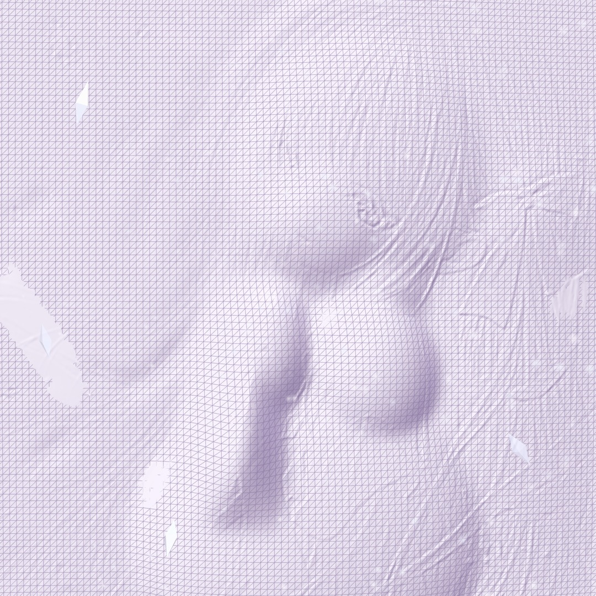

# Sakura Silk CG (`sakura-silk-cg`)

<p align="center">
  <b>高保真日系 3D Anime CG 角色重建、动态法线重打光与 8s 24fps 电影级短片实时渲染工程</b><br/>
  <sub>Built with Three.js · Custom GLSL Shaders · 16-bit Depth & Surface Normal Reconstruction</sub>
</p>

<p align="center">
  
  
  
</p>

<p align="center">
  
  
</p>

> **成品短片预览 / 下载**：[`output/anime_3d_cg_8s_24fps.mp4`](output/anime_3d_cg_8s_24fps.mp4)（`1080×1080` · `24fps` · 共 `192` 帧）

---

## 核心技术架构

1. **460,800 三角面 16-bit 三维置换网格**  
   通过 [`scripts/build_3d_assets.py`](scripts/build_3d_assets.py) 融合角色解剖体块三维先验与明暗恢复形状（Shape-from-Shading）微结构浮雕，将 `16-bit` 连续高度场打包至 `RG` 双通道（`assets/depth_map.png`），消除传统 8-bit 深度图的断层伪影。
2. **动态法线重打光与逆光半透明发丝（SSS / Rim Scattering）**  
   基于精细法线贴图（`assets/normal_map.png`）在 GLSL 片元着色器中实时计算随 3D 镜头视差环绕变化的银粉色漫反射增量、发丝各向异性高光及逆光边缘散射。
3. **零失真刚性锁与分区域物理风场模拟**  
   利用四通道语义遮罩（`assets/rig_masks.png`）锁定角色面部骨骼、五官与胸前双手结构 `100%` 零形变；仅对超长粉白发束、耳侧白色丝绸蝴蝶结飘带与多层荷叶边薄纱连衣裙施加三维风场行波运动。
4. **Live2D 级亚像素表情与镜头分镜状态机（`0–8s`）**  
   - `0–2s`：`85mm` 人像镜头自正侧方缓慢推进，微风轻拂长发，三维散景光粒漂浮。
   - `2–4s`：镜头向右平滑环绕产生真实三维视差，灰紫眼眸轻抬看向镜头、纤长睫毛微颤并浮现自然浅笑。
   - `4–6s`：风力微增，丝绸蝴蝶结与薄纱荷叶边裙摆轻盈摆动，逆光穿透半透明发丝，折射八面体水晶闪烁柔和蓝紫光芒。
   - `6–8s`：平滑定格于少女面部浅景深特写，自然眨眼，前景半透明 3D 发丝从面颊旁轻柔滑过。

---

## 快速运行指南

### 1. 启动实时 3D 交互预览器

```bash
npm install
npm start
```

打开浏览器访问 `http://127.0.0.1:3080`：
- 支持播放 / 暂停 / 任意拖拽 **0.00s – 8.00s** 电影运镜时间轴
- 支持切换 **自由 3D 视差视角**（鼠标旋转、滚轮缩放）
- 支持一键切换 **3D 浮雕白模 / 线框拓扑视图**

### 2. 重新构建三维深度、法线与权重资产（可选）

```bash
# 需要 Python 3 环境 (numpy, Pillow, scipy)
npm run build:assets
```

### 3. 硬件加速离线渲染静帧与 8 秒 MP4 短片

```bash
# 渲染 1440x1440 高清关键帧与三维线框验证图
npm run render:preview

# 逐帧渲染 192 帧 (1080x1080 @ 24fps) 并调用本地 FFmpeg 编码 H.264 MP4
npm run render:video
```

---

## 仓库目录结构

```text
sakura-silk-cg/
├── assets/                     # 3D 重建核心纹理资产
│   ├── albedo_hd.jpg           # 1536×1536 高清角色 CG 色彩纹理
│   ├── depth_map.png           # 16-bit RG 双通道高精度三维深度图
│   ├── normal_map.png          # 表面法线贴图 (Surface Normal Map)
│   ├── rig_masks.png           # 四通道语义物理权重与刚性锁遮罩
│   └── source_cg_reference.jpg # 原始 1:1 CG 重构基准图
├── docs/                       # 文档展示预览图集
│   ├── hero_beauty.jpg         # 0.4s 近景半身渲染
│   ├── mid_smile_orbit.jpg     # 3.8s 环绕视差与抬眸浅笑关键帧
│   ├── closeup_final.jpg       # 7.6s 85mm 面部特写定格
│   ├── normal_map.jpg          # 法线贴图可视化
│   └── hero_wireframe.jpg      # 46万面三维浮雕白模与线框拓扑
├── output/
│   └── anime_3d_cg_8s_24fps.mp4 # 8秒 24fps 电影级成品短片
├── scripts/                    # 构建、服务与离线渲染工具链
│   ├── build_3d_assets.py      # Python 16-bit 深度/法线/权重生成脚本
│   ├── render_runner.js        # Headless WebGL 硬件加速渲染与 FFmpeg 合成器
│   └── serve.js                # 本地交互预览开发服务器
├── src/                        # 前端实时三维渲染源码
│   ├── main.js                 # Three.js 场景、85mm 运镜状态机与交互控制
│   └── cinematic3dCharacter.js # 46万面 3D 置换网格、动态法线重打光与亚像素表情着色器
├── .gitignore
├── index.html                  # WebGL 实时交互预览入口
├── LICENSE                     # MIT License
├── package.json
└── README.md
```

---

## License

Released under the [MIT License](LICENSE).
