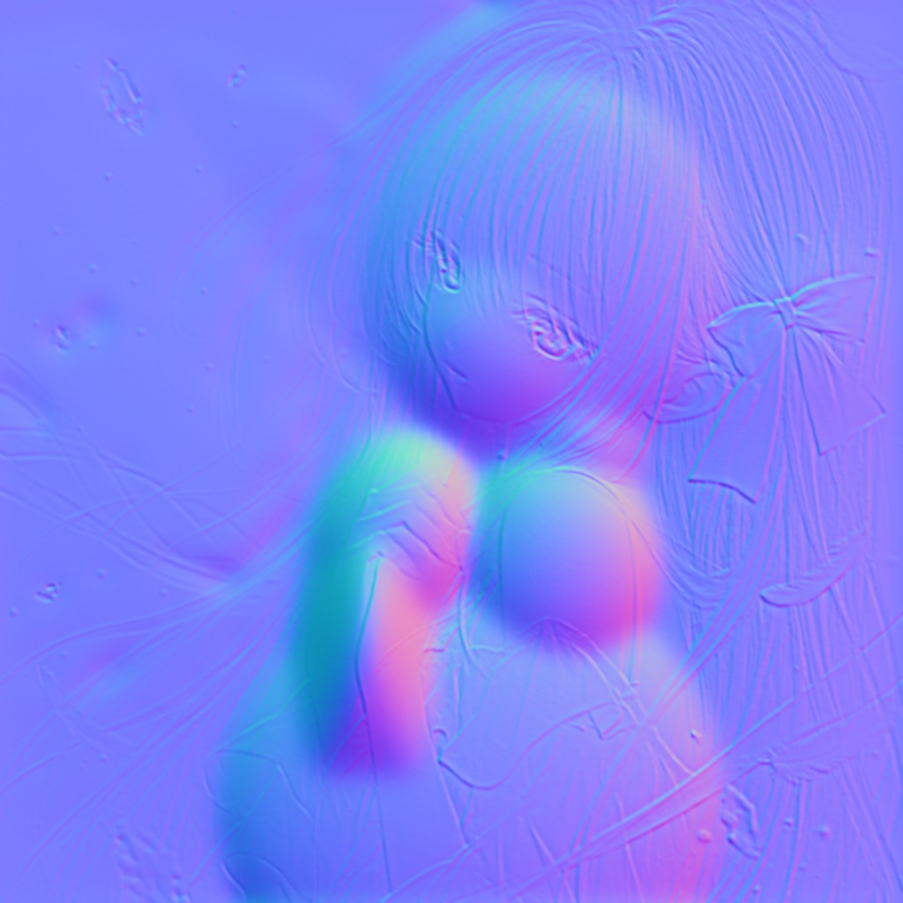

# Sakura Silk CG (`sakura-silk-cg`)

基于 **Three.js**、**自定义 GLSL 着色器** 与 **Python 16-bit 深度/法线重建管线** 实现的高保真日系 3D Anime CG 角色建模、实时视差交互与 **8 秒 24fps 电影级短片渲染系统**。

<p align="center">
  
  
</p>

<p align="center">
  
  
</p>

---

## 核心特性

- **460,800 三角面 16-bit 三维置换网格**：通过 `build_3d_assets.py` 融合角色解剖体块深度先验与明暗恢复形状（Shape-from-Shading）微结构浮雕，将 16-bit 高度场编码至 RG 双通道，消除 8-bit 台阶伪影。
- **动态法线重打光与逆光半透明发丝（SSS / Rim Scattering）**：实时计算表面法线贴图在镜头环绕与体积逆光变化下的漫反射增量、各向异性微高光与银粉色边缘散射。
- **零失真刚性锁与三维风场物理模拟**：利用四通道语义权重图（`rig_masks.png`）严格锁定面部骨骼、五官与双手结构零形变，同时驱动粉白长发、耳侧白色丝绸蝴蝶结飘带与多层荷叶边欧根纱裙摆产生自然的风场行波运动。
- **亚像素面部表演绑定**：支持 `2–4s` 柔和抬眸看向镜头、纤长睫毛微颤、自然浅笑以及 `6–8s` 顺滑眨眼动画。
- **三维前景氛围粒子与折射晶簇**：内置物理透射八面体水晶碎片（`ior = 1.56` + 蓝紫虹彩反射）、面颊飘过的半透明 3D 发丝与 150 颗浅景深三维散景光粒。

---

## 快速开始

### 1. 安装依赖并启动实时 3D 交互预览器

```bash
npm install
npm start
```

浏览器访问 `http://127.0.0.1:3080`，支持：
- 播放 / 暂停 / 拖拽 **0.00s – 8.00s** 电影分镜时间轴
- 切换 **自由 3D 视差视角**（鼠标拖拽环绕、滚轮缩放）
- 一键切换 **3D 浮雕白模 / 线框拓扑视图**

### 2. 重新生成 16-bit 深度、法线与物理权重贴图（可选）

```bash
# 依赖 Python numpy, Pillow, scipy
npm run build:assets
```

### 3. 离线渲染高清静帧与 8 秒 24fps MP4 短片

```bash
# 渲染 1440x1440 预览静帧与线框图
npm run render:preview

# 逐帧渲染 192 帧 (1080x1080 @ 24fps) 并调用 FFmpeg 合成 MP4
npm run render:video
```

成品视频输出路径：`output/anime_3d_cg_8s_24fps.mp4`。

---

## 目录结构

```text
sakura-silk-cg/
├── assets/                     # 1536p 高清纹理、16-bit 深度图、表面法线贴图与四通道物理绑定遮罩
├── docs/                       # 渲染成品与三维网格拓扑展示图
├── output/                     # 导出的 8s 24fps 电影级短片 (MP4)
├── src/
│   ├── main.js                 # Three.js 85mm 镜头运镜状态机、交互控制与离线逐帧导出
│   ├── cinematic3dCharacter.js # 46万面 3D 置换网格、动态法线重打光与亚像素表情 GLSL 着色器
│   ├── shaders.js              # 扩展程序化 SSS 皮肤、Kajiya-Kay 发丝与薄纱着色器库
│   ├── headAndBody.js          # 扩展参数化三维头雕与手部骨骼模块
│   ├── hairAndCostume.js       # 扩展 Catmull-Rom 3D 发束与多层荷叶边薄纱模块
│   └── atmosphere.js           # 扩展三维晶簇、轻羽与体积光带模块
├── build_3d_assets.py          # Python 16-bit 深度场、法线贴图与物理权重生成脚本
├── render_runner.js            # 自动化 Headless WebGL 硬件加速渲染与 FFmpeg 编码器
├── serve.js                    # 本地开发与交互预览服务器
└── index.html                  # WebGL 交互预览前端入口
```
